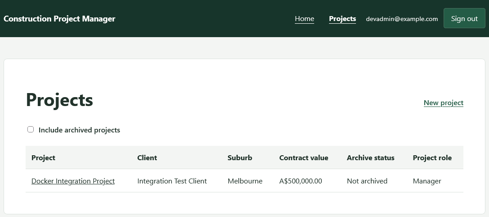
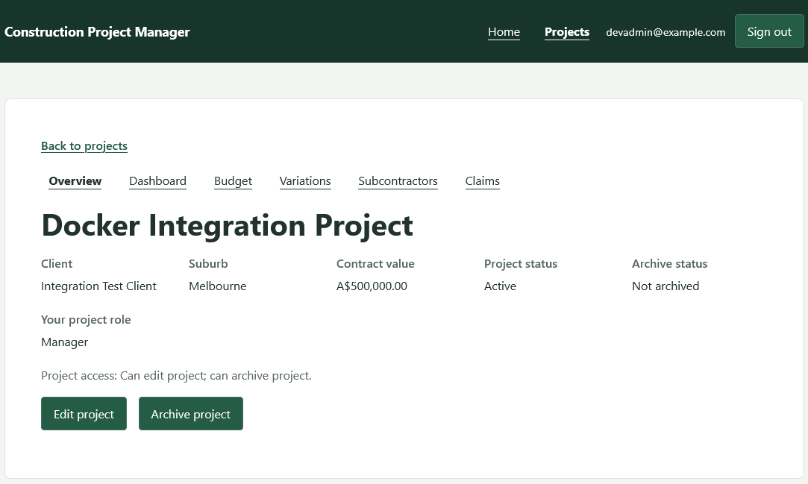
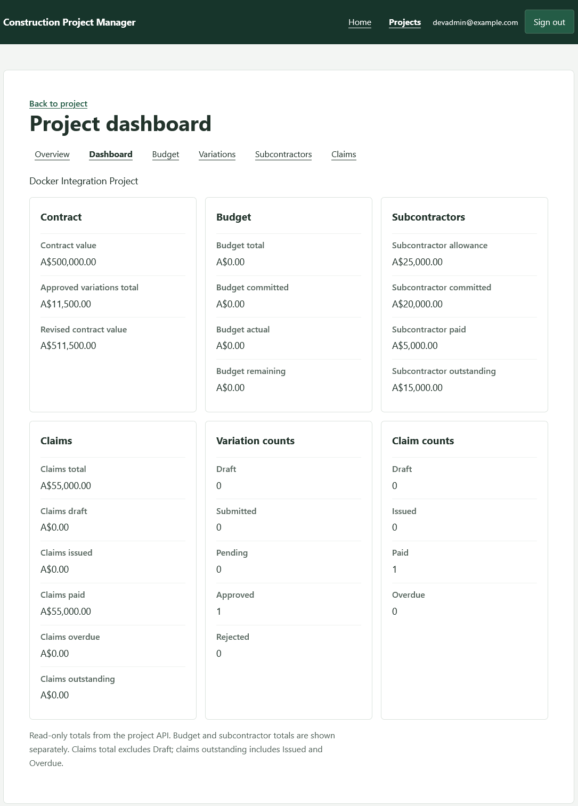
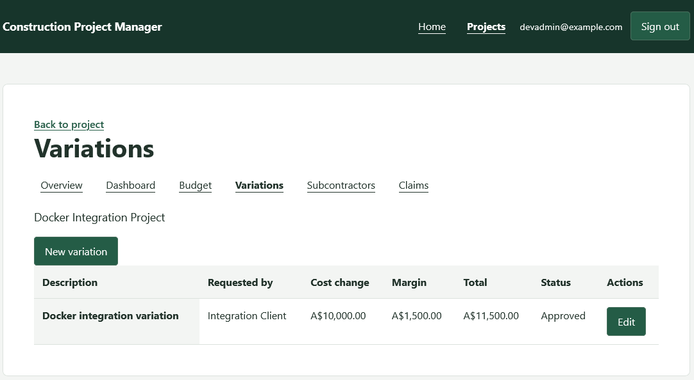
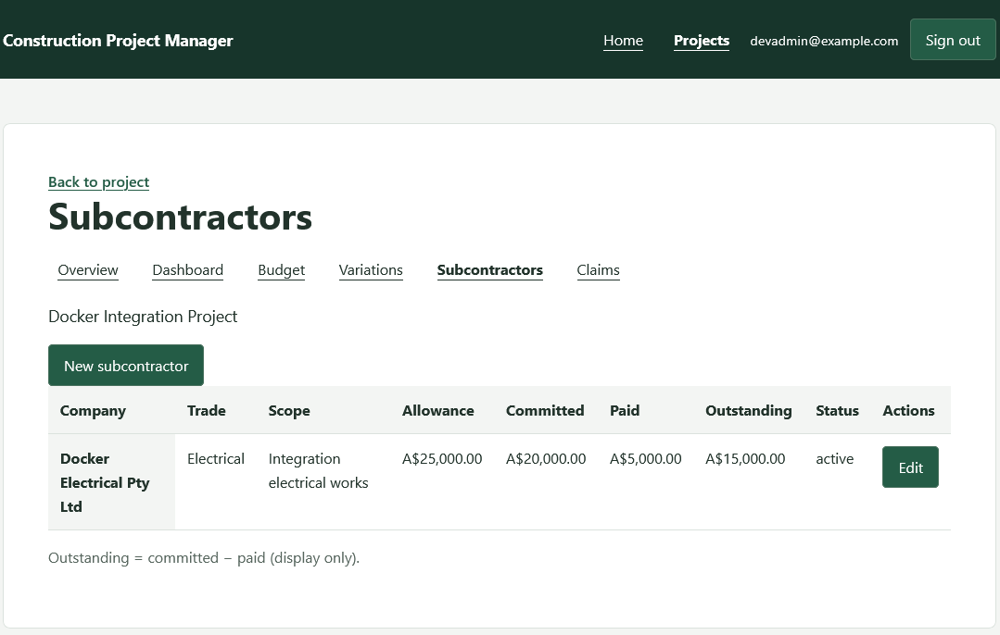
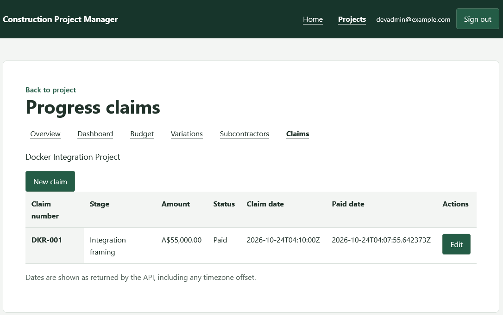

# Construction Project Management System

A full-stack construction management system that centralizes project records and financial workflows: budgets, variations, subcontractor commitments and progress claims. A shared project workspace and financial dashboard bring together information that would otherwise sit in separate spreadsheets.

This is a fictional portfolio/demo project, not a commercial service or a production-certified system. Use fictional data only; no real client data or credentials belong in this repository.

## What this project demonstrates

- Full-stack development with React, FastAPI and PostgreSQL
- Authentication and project-level permissions
- Construction financial workflows with backend-authoritative calculations
- Docker Compose deployment with persistent storage
- Automated frontend tests and a full-stack browser E2E workflow
- Production-oriented deployment hardening, with documented HTTPS, proxy-trust and recovery requirements

## Implemented features

| Area | Available functionality |
| --- | --- |
| Projects and overview | List accessible projects, create and edit project details, view contract value and project role, and archive with confirmation. Archived projects are hidden by default and can be included in the list; archiving does not delete their records. |
| Budgets | Read-only category table showing budget, committed, actual and remaining amounts. The frontend does not create or edit budgets. |
| Variations | Create and edit descriptions, requester, cost change, margin and status. The backend calculates the total. Statuses include Draft, Submitted, Pending, Approved and Rejected. |
| Subcontractors | Create and edit company, trade, scope, allowance, committed and paid amounts, and status. Display outstanding commitments. |
| Progress claims | Create and edit claim number, stage, amount, dates and Draft/Issued/Paid/Overdue status. The backend supplies a paid timestamp when marking a claim Paid without one. |
| Dashboard | Read-only contract, budget, subcontractor and claim totals, plus variation and claim counts by status. |

Write controls depend on the user's permissions. Project modules share navigation, including direct links to nested screens.

## Screenshots

### Projects


Project list showing active projects and top-level navigation.

### Project overview


Project overview with contract details, project role and module navigation.

### Dashboard


Dashboard summarising contract, variation, subcontractor and progress-claim KPIs.

### Variations


Variation tracking with cost change, margin, backend-calculated total and status.

### Subcontractors


Subcontractor commitments showing allowance, committed, paid and outstanding values.

### Progress claims


Progress-claim tracking with amount, status, claim date and paid date.

## Architecture and stack

```text
Browser
  -> nginx / React SPA             frontend, host port 8080
      -> FastAPI JSON API         backend:8000, internal
          -> PostgreSQL           postgres:5432, internal
              -> postgres_data    persistent named volume

Docker Compose manages the three services.
```

React runs in the browser; nginx serves its built assets and proxies API requests. HTML navigation and JSON API requests can share `/projects` paths: nginx distinguishes them by request method and `Accept` header. Vite provides the equivalent routing during local development.

| Layer | Technologies |
| --- | --- |
| Frontend | JavaScript, React 19, React Router 7, Vite 7, CSS |
| Backend | Python, FastAPI, Pydantic, SQLAlchemy, psycopg, Uvicorn |
| Data | PostgreSQL 16, Alembic migrations |
| Authentication | PyJWT, pwdlib with Argon2 |
| Tests | Vitest, React Testing Library, pytest, Playwright (Chromium) |
| Containers | Docker Compose, nginx; Python 3.11 backend image |

Dependency declarations are in [`frontend/package.json`](frontend/package.json) and [`backend/requirements.txt`](backend/requirements.txt). Uvicorn is installed separately in the [backend Dockerfile](backend/Dockerfile).

### Implementation principles

- The backend owns variation totals and dashboard aggregates. Revised contract value is original contract value plus Approved variations only. Claims total excludes Draft; outstanding claims are Issued plus Overdue. Budget and subcontractor totals remain separate.
- PostgreSQL `NUMERIC` and Python `Decimal` handle financial values. API amounts are decimal strings; frontend formatting and display-only subtraction use strings and integer cents rather than binary floating-point money arithmetic.
- Existing-project write controls require explicit backend capability flags. Missing flags hide controls; API authorization remains authoritative. Project creation uses the backend's Admin/Project Manager system-role rule.
- SPA navigation stays separate from JSON responses, even where URLs overlap. Persistent database storage is separate from application containers.

## Authentication and security

The frontend keeps JWT access tokens in memory, not local storage. Refresh tokens use an HttpOnly, SameSite=Strict cookie scoped to `/auth`; the backend stores their hashes, checks expiry and rotates them on refresh. A JavaScript-readable CSRF cookie at `/` supplies the matching header for refresh and cookie-backed logout. Passwords are hashed with Argon2 through pwdlib.

The API checks current database roles and project membership. Self-registration through the API creates a Viewer; there is no bundled privileged demo account or frontend account-administration screen. Arrange an authorized demo account separately to exercise project creation.

Secrets must be supplied externally. `COOKIE_SECURE=false` is for local HTTP only. Public HTTPS, proxy trust, backups and operational checks require operator configuration; see [DOCKER.md](DOCKER.md). These mechanisms are not a security certification.

## Run with Docker

Requires Docker Engine and Compose v2. Follow [DOCKER.md](DOCKER.md) to prepare an external environment file and select the correct Compose identity and overrides. Then, from the repository root:

```sh
export DOCKER_ENV="$HOME/.config/construction-stage7a.env"
docker compose --env-file "$DOCKER_ENV" up -d --build
docker compose --env-file "$DOCKER_ENV" ps
```

Open `http://127.0.0.1:8080`. Startup applies database migrations automatically. See [DOCKER.md](DOCKER.md) for HTTPS, backups/restores, production security, upgrades and rollback; retain any required overrides when running these commands.

## Local development

Use Python 3.11 to match the backend image, PostgreSQL 16 with the `libpq` runtime available, and Node matching `^20.19.0 || >=22.12.0`. Provision a separate development database and supply environment values yourself; setup does not seed accounts or project data.

Prepare a trusted, shell-compatible environment file outside the repository, with mode 600 and a restricted parent directory. Use these keys with your own values, not the placeholders:

```dotenv
DATABASE_URL='postgresql+psycopg://<user>:<url-encoded-password>@127.0.0.1:5432/<development-database>'
AUTH_SECRET='<independent-random-secret; recommended 64 hex characters>'
COOKIE_SECURE=false
```

The backend reads process environment variables; it does not automatically load `.env`. In Bash, from the repository root:

```sh
python3 -m venv backend/.venv
source backend/.venv/bin/activate
python -m pip install -r backend/requirements.txt uvicorn==0.34.3
set -a
source "$HOME/.config/construction-development.env"
set +a
cd backend
alembic upgrade head
uvicorn app.main:app --reload --host 127.0.0.1 --port 8000
```

In another terminal, from the repository root:

```sh
cd frontend
npm ci
npm run dev -- --host 127.0.0.1
```

Open the URL printed by Vite. Its configured proxy targets `http://127.0.0.1:8000`; no frontend environment variables are required. Never put secrets in `VITE_*` variables.

## Testing and verification

Latest verified results: **212 frontend Vitest tests passed** and **1 Playwright full-stack E2E workflow passed**.

Frontend tests cover authentication, permissions, project modules, financial formatting and navigation. Run them from `frontend/`:

```sh
npm test -- --run
npm run build
```

The [Playwright workflow guide](frontend/e2e/README.md) documents credentials, browser setup and the real-stack test. It exercises sign-in, project creation, an approved variation, subcontractor commitments, claim editing/payment, dashboard reconciliation, nested navigation, session restoration and logout. It writes fictional records and leaves them for inspection; run it only against an approved demo workspace.

Backend pytest tests in [`backend/tests/`](backend/tests/) cover authentication, authorization, models, financial modules and API contracts against PostgreSQL. They require a separate `TEST_DATABASE_URL` targeting `construction_test_db`; fixtures can create and drop tables. Never point them at a development database containing useful data or a client database. No backend pass count is claimed here because no checked-in execution result establishes one.

## Repository structure

```text
.
├── backend/
│   ├── app/
│   │   ├── auth/                 # Authentication and database dependencies
│   │   ├── models/               # SQLAlchemy models
│   │   ├── projects/             # Projects, budget API and capabilities
│   │   ├── variations/
│   │   ├── subcontractors/
│   │   ├── claims/
│   │   ├── dashboard/
│   │   └── main.py               # FastAPI entry point
│   ├── alembic/                  # Database migrations
│   ├── tests/                    # pytest coverage
│   ├── requirements.txt
│   ├── Dockerfile
│   └── docker-entrypoint.sh
├── frontend/
│   ├── src/                      # Pages, forms, auth, API client and unit tests
│   ├── e2e/                      # Playwright workflow and run guide
│   ├── package.json
│   ├── vite.config.js
│   ├── nginx.conf
│   └── Dockerfile
├── .env.example                  # Configuration keys, not credentials
├── compose.yaml
├── DOCKER.md                     # Deployment and operations
└── README.md
```

## Possible next steps

Document attachments, notifications, reporting/export, mobile usability improvements, and CI/cloud deployment automation are future work, not current features.
